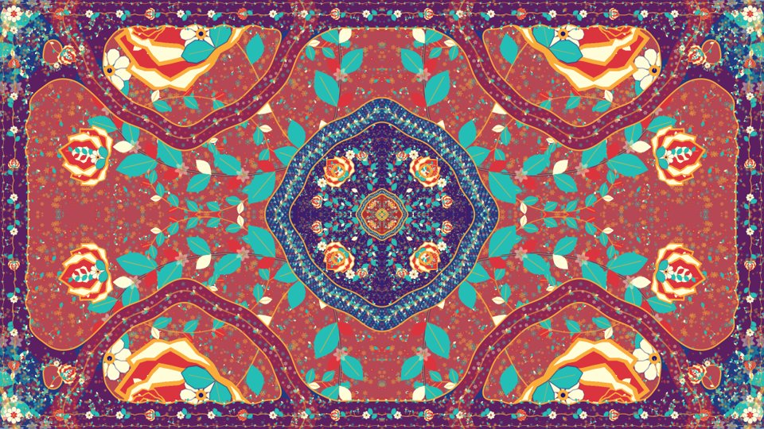

# Persian Carpets

Procedural Persian-inspired carpet screensavers for Android TVs, projectors and desktop browsers. The drawing itself morphs: leaves, flowers, rosettes, corners and borders change their geometry.

**Два отдельных приложения:** «Ковры: морфинг» и «Ковры: зум». Можно установить оба. Они работают без интернета и не требуют разрешений.



## Download

- [Morph APK](https://github.com/volodarskij/persian-carpets/raw/refs/heads/main/releases/v1.0.0/persian-carpets-morph-1.0.0.apk)
- [Zoom APK](https://github.com/volodarskij/persian-carpets/raw/refs/heads/main/releases/v1.0.0/persian-carpets-zoom-1.0.0.apk)
- [Release and checksums](https://github.com/volodarskij/persian-carpets/tree/main/releases/v1.0.0)

Android 8.0/API 26 or newer, OpenGL ES 2.0. These are signed sideload builds, not Play Store packages.

## Use

Install either or both APKs and open the corresponding app from the TV launcher. Back exits. For automatic activation, select the desired entry in Android's screen saver settings. Availability and idle activation depend on the TV firmware. The apps do not change the selected system screensaver, sleep settings or remote-key mappings.

| App | Package ID | Motion |
| --- | --- | --- |
| Ковры: морфинг | `com.volodarskij.carpets.morph` | A detailed 16:9 composition changes over 38 seconds. |
| Ковры: зум | `com.volodarskij.carpets.zoom` | An unfolding center and secondary waves repeat seamlessly every 18 seconds while the drawing morphs. |

Open `docs/index.html` locally for the self-contained desktop preview with both modes, pause, fullscreen and keyboard controls.

## Drawing

- Reflected quarter compositions with several flower centers, without translated rows or columns of field tiles.
- Saturated flat backgrounds assigned to successive unfolding levels; no flowing color gradients.
- Rosette bands, corners and the outer hem merge into shared shapes with a common outline.
- Fine botanical details fill both junctions and exposed gaps. They retain a small scale as the large drawing expands and leave flower faces clear.
- One shared JavaScript engine prepares packed vector poses. Native GLES interpolates vertices each frame; the invisible WebView only calculates future poses.

## Build

Install JDK 17 and Android SDK platform/build-tools 34. Set `ANDROID_HOME` or create a local `local.properties` with `sdk.dir=...`.

```sh
node tools/export-shaders.cjs
./gradlew :app:lintMorphRelease :app:lintZoomRelease :app:assembleMorphRelease :app:assembleZoomRelease
```

Use `gradlew.bat` on Windows. APKs appear under `app/build/outputs/apk/{morph,zoom}/release/`. The checked-in build uses the local Android debug signing identity for sideloading. Signing keys are not included; configure your own persistent signing identity when distributing future updates.

## Verification

```sh
npm ci
npm test
npx playwright install chromium
npm run test:gpu
```

To test with an installed browser, set `CARPET_BROWSER` to its executable. Tests cover packed poses, stable morph topology, exact geometry endpoints, polygon fans, shader parity, solid joins, flat pigments, constant outlines, mirror symmetry and recursive zoom boundaries. Android release lint and signature checks are also part of release verification.

The app declares no network/storage permissions. Assets are bundled, and the calculation WebView blocks network, file and content access. Neither photographs nor external textures are bundled: all ornament is generated.

On the tested Android 9 projector with Mali-450 MP, zoom measured 21.3–21.7 FPS and morph 30.4–31.1 FPS, with no geometry starvation or GL errors in the recorded samples. These are measured ranges, not guaranteed frame rates on other devices. See [verification notes](docs/verification.md).
